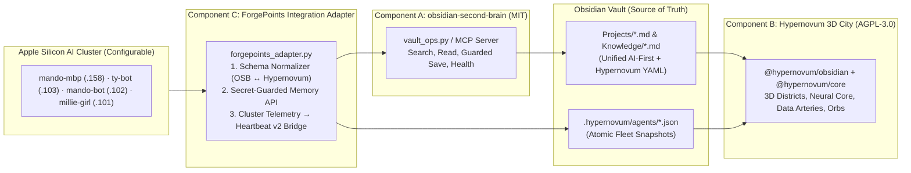

# Architecture Assessment & Integration Blueprint

## 1. Upstream Repository Reconnaissance Findings

### A. `eugeniughelbur/obsidian-second-brain` (`v0.19.0` · MIT)
- **Architecture:** Cross-CLI skill compiler (`commands/*.md` -> 8 platform targets in `dist/<platform>/` via `scripts/build.sh`) + deterministic Python engine (`scripts/*.py`) + pure-stdlib MCP server (`integrations/obsidian-mcp-server/vault_ops.py` & `server.py`).
- **Runtime Requirement Discovery:** `scripts/bootstrap_vault.py` and `scripts/*.py` use PEP 604 union syntax (`bool | None`) without `from __future__ import annotations`, which **crashes macOS Xcode system Python 3.9.6** (`TypeError: unsupported operand type(s) for |`). Must be executed with Homebrew Python `>=3.10` (`/opt/homebrew/bin/python3` / `uv run`, which uses Python `3.14.3` on our nodes).
- **Canonical Data Contract (`references/ai-first-rules.md`):**
  - Requires YAML frontmatter (`date`, `updated`, `type`, `tags`, `ai-first: true`) followed immediately by a `## For future agent` H2 preamble.
  - Supports typed graph edges in frontmatter (`relations: { depends_on: [...], supersedes: [...], caused_by: [...] }`) and inline `[[wikilinks]]`.
  - Enforces immutable `raw/` captures, `index.md` catalog updates, and `Logs/YYYY-MM-DD.md` operation logs on every write.
- **Existing MCP Tools (`integrations/obsidian-mcp-server/server.py`):** `obsidian_search`, `obsidian_read_note`, `obsidian_save_note`, `obsidian_capture`, `obsidian_update_note`, `obsidian_validate_note`, `obsidian_backlinks`, `obsidian_vault_health`, `obsidian_list_skills`, `obsidian_get_skill`.

### B. `Pardesco/hypernovum` (`v0.7.0` · AGPL-3.0-only)
- **Architecture:** npm workspaces monorepo:
  - `@hypernovum/core` (`packages/core/`): Platform-agnostic Three.js (`^0.160.0`) + Zustand (`^4.4.0`) 3D city renderer (`SceneManager`, `BuildingFactory`, `TowerLoft`, `NeuralCore`, `DataArtery`, `EdgeManager`, `BinPacker`).
  - `@hypernovum/obsidian` (`packages/obsidian-plugin/`): Obsidian Desktop plugin wrapping `@hypernovum/core` with `ProjectParser`, `ActivityMonitor`, `GitCollector`, `DependencyScanner`, `ConflictDetector`, and `TerminalLauncher`.
- **3D City Data Contract (`SCHEMA.md` & `ProjectParser.ts`):**
  - Detects any note where `type: project` or `tags` includes `project`.
  - Maps `status` (`active|blocked|paused|complete`) -> building color; `priority` (`critical|high|medium|low`) -> building height (1–8 stories); `stage` -> X-axis; `category` -> Z-axis district; `tasks`/`tasks_done` -> lit building windows; `questions`/`answered` -> floating quest gems; `depends_on`/`blocked_by` -> 3D directed arcs; `projectDir` -> local Git weather & agent attachment.
- **Live Agent Fleet Contract (`scripts/heartbeat.js` & `ActivityMonitor.ts`):**
  - Polls `<vault>/.hypernovum/agents/<sessionId>.json` every `500ms` (with `10,000ms` active window).
  - Each active session renders as a state-colored orb orbiting its target building with a streaming `DataArtery` from the central `NeuralCore`.

---

## 2. Schema Compatibility & Unified Frontmatter Bridge

**Crucial Architectural Discovery:** `obsidian-second-brain` and `hypernovum` both read YAML frontmatter from Markdown notes in `Projects/`, and their schemas are **100% composable** when bridged through a unified frontmatter contract, with **four specific field translations** handled by our `ForgePointsAdapter`:

| Concept | `obsidian-second-brain` (`ai-first-rules.md`) | `hypernovum` (`SCHEMA.md`) | ForgePoints Unified Contract |
| :--- | :--- | :--- | :--- |
| **Project Detection** | `type: project` + `tags: [project, ...]` + `ai-first: true` | `type: project` OR `tags: [project]` | Include all three (`type: project`, `tags: [project, ...]`, `ai-first: true`) + `## For future agent` preamble. |
| **Repo / Directory Path** | `repo: /path/or/url` | `projectDir: /abs/path` *(unquoted on Windows, POSIX path on macOS)* | Adapter synchronizes `repo` and `projectDir` so both `/obsidian-projects` and Hypernovum Git/Agent attachment work. |
| **Status Vocabulary** | `active \| planning \| completed \| archived \| on-hold` | `active \| blocked \| paused \| complete` | Adapter maps `planning -> stage: backlog, status: active`, `completed -> complete`, `on-hold -> paused`. |
| **Dependency Edges** | `relations.depends_on: ["[[Projects/X]]"]` & `related-projects` | Top-level `depends_on: ["[[Projects/X]]"]` & `blocked_by` | Adapter mirrors `relations.depends_on` to top-level `depends_on` so Hypernovum draws teal 3D dependency arcs while OSB `link_graph.py --lint` passes. |

---

## 3. Component Boundaries

